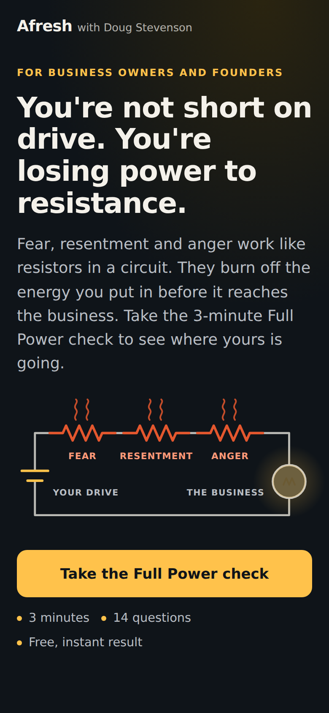
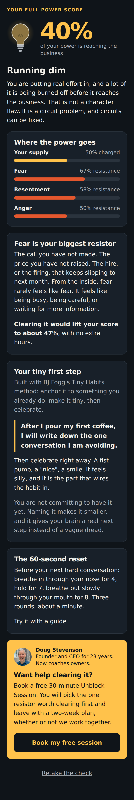
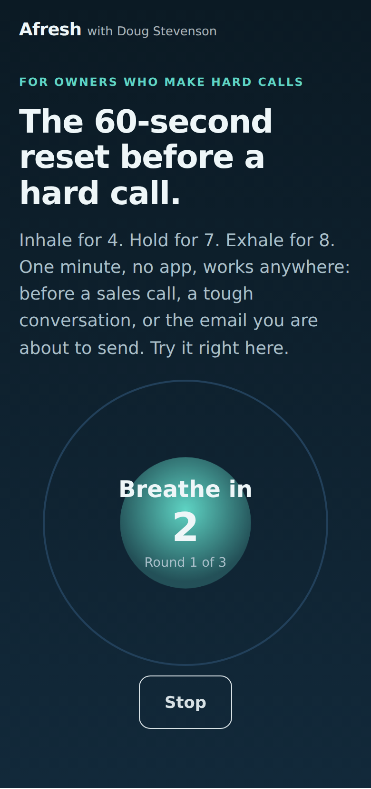
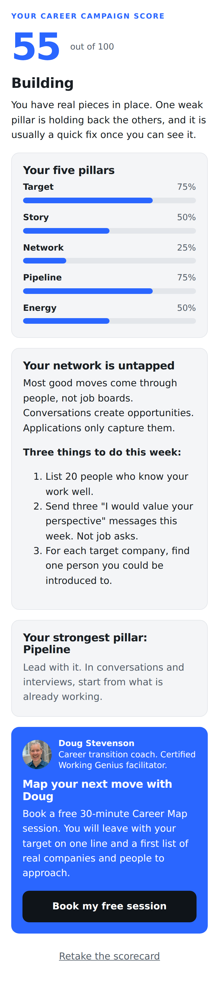
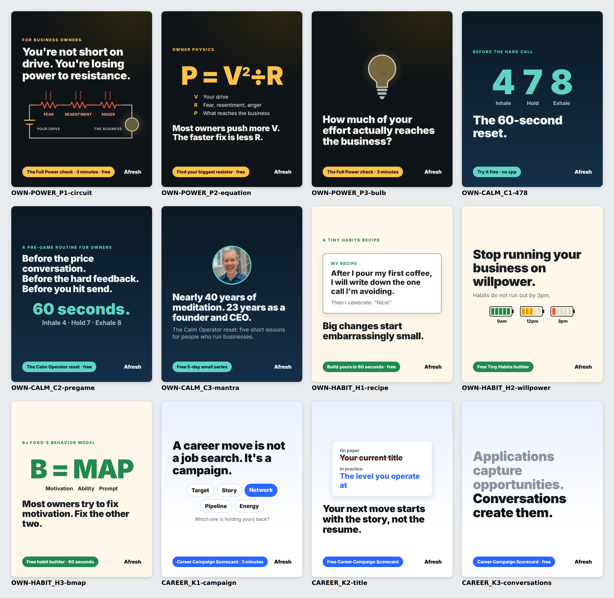

# Afresh Facebook ad test kit

A ready-to-run Facebook and Instagram ad test to find which audience and message books coaching clients for Doug Stevenson (afresh.io).

**The recommendation:** lead with **business owners and founders**, and the idea that fear, resentment and anger act like resistors, burning off an owner's drive before it reaches the business (**P = V² ÷ R**). Test it against three alternatives for two weeks, about $1,400, and pick the winner on cost per qualified lead:

| Cell | Audience | Angle | Landing page |
|---|---|---|---|
| OWN-POWER | Owners and founders | Resistance: the Full Power check | [`site/full-power/`](site/full-power/index.html) |
| OWN-CALM | Owners and founders | The 60-second reset before a hard call (4-7-8) | [`site/reset/`](site/reset/index.html) |
| OWN-HABIT | Owners and founders | Stop running your business on willpower (Tiny Habits) | [`site/tiny-habits/`](site/tiny-habits/index.html) |
| CAREER | Experienced professionals | A career move is a campaign, not a job search | [`site/career-move/`](site/career-move/index.html) |

The reasoning, budget, targeting and decision rules are in **[docs/campaign-plan.md](docs/campaign-plan.md)**.

<p>




</p>



## What's here

| Path | What it is |
|---|---|
| [docs/campaign-plan.md](docs/campaign-plan.md) | Cohort choice, positioning, funnel, test design, budget, metrics, decision rules, risks |
| [docs/launch-checklist.md](docs/launch-checklist.md) | Pixel, HubSpot, Calendly, deploy to afresh.io, build in Ads Manager, QA, daily routine |
| [docs/program-and-nurture.md](docs/program-and-nurture.md) | The 8-week Full Power program, the stress and sleep toolkit, email series, Doug's follow-up, video scripts |
| [docs/ads.md](docs/ads.md) | Every ad with its copy and images (generated) |
| `ads/ads.json` | Source of truth for all ad copy |
| `ads/out/` | Rendered ads: `_feed.png` (4:5) and `_story.png` (9:16) for each |
| `ads/ads-sheet.csv` | One row per ad for building in Ads Manager (generated) |
| `ads/results-template.csv` | Daily results log |
| `site/` | The landing pages: static HTML, CSS and JS, no build step |
| `site/lp-assets/config.js` | **The only file to edit before launch:** Pixel ID, HubSpot form, Calendly link |

## How the pages work

- Each page gives something useful straight away: a scored assessment, a guided breathing reset, a habit recipe builder.
- Leads go to HubSpot (and optionally a webhook) with the ad that produced them: `utm_term` is the ad set, `utm_content` is the ad.
- The Meta Pixel gets `ViewContent`, `Lead` (with a dedup `eventID` for a later Conversions API setup) and `Schedule` when someone books through the Calendly popup, plus custom funnel events.
- The booking link is prefilled with the person's name, email, result and what they are putting off, so Doug walks into the call prepared.
- `?gate=soft` on either assessment shows the result before asking for an email, for a later test.

## Commands

```bash
npm install
npm run serve        # http://localhost:4173/full-power/ (also /reset/, /tiny-habits/, /career-move/)
npm run lint:ads     # Meta policy and house-style checks on ad and page copy
npm test             # unit tests + browser tests on a phone-sized Chromium
npm run check        # all of the above
npm run render:ads   # re-render ad images after editing ads/ads.json or ads/creatives.mjs
npm run build:docs   # regenerate docs/ads.md and ads/ads-sheet.csv
node scripts/contact-sheet.mjs feed   # overview image of all ads
node scripts/screenshots.mjs          # phone screenshots of every page (needs npm run serve)
```
