# Ad copy deck: R1_OwnerAngles_Leads

Generated from `ads/ads.json` by `npm run build:docs`. Edit the JSON, not this file.

Every ad uses the same URL parameters (paste into the ad's **URL parameters** field):

```
utm_source=facebook&utm_medium=paid_social&utm_campaign={{campaign.name}}&utm_term={{adset.name}}&utm_content={{ad.name}}
```

## OWN-POWER: Resistance: fear, resentment and anger burn off the owner's drive (P = V^2 / R)

- **Ad set:** `R1_OWN-POWER`
- **Audience:** Business owners and founders
- **Landing page:** https://afresh.io/full-power/
- **Lead magnet:** Full Power check (14-question assessment, gated result)
- **Hypothesis:** The most differentiated angle. Expect the best lead quality and booking rate, possibly a higher cost per lead than CALM.

### `R1_OWN-POWER_P1-circuit`

| Feed 4:5 | Story 9:16 |
|---|---|
| 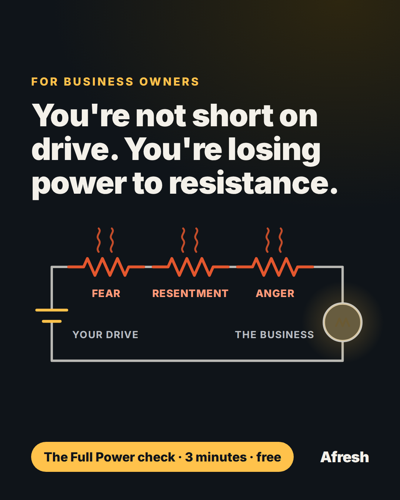 | 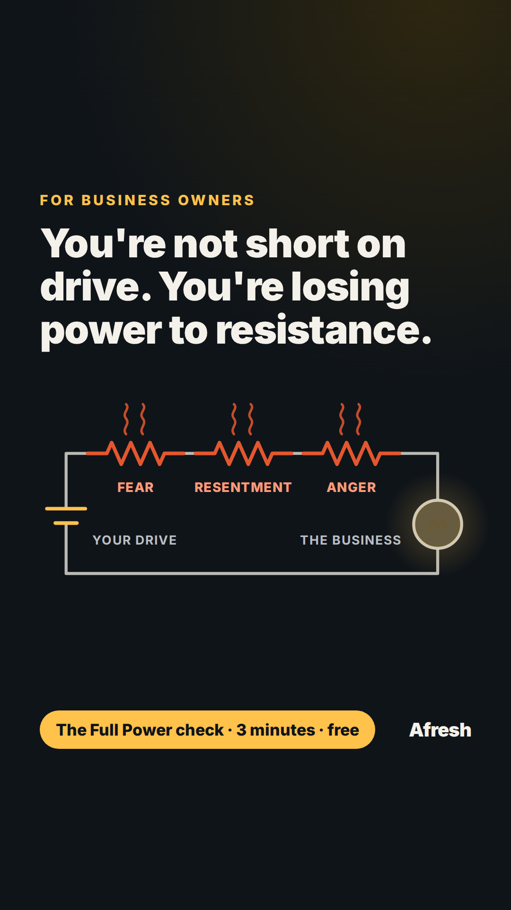 |

**Primary text**

> You're not short on drive. You're losing power to resistance.
> 
> In a circuit, the bulb only gets the power that makes it past the resistors. The rest turns into heat.
> 
> In a business, the resistors are fear, resentment and anger. The call that keeps slipping to next month. The partner nobody says anything to. The email that should never have been sent.
> 
> The free Full Power check takes 3 minutes. It shows how much of your energy reaches the business, which resistor costs the most, and one tiny step to clear it.

**Headline:** Take the 3-minute Full Power check  
**Description:** Free. Instant result.  
**Button:** Learn more

### `R1_OWN-POWER_P2-equation`

| Feed 4:5 | Story 9:16 |
|---|---|
| 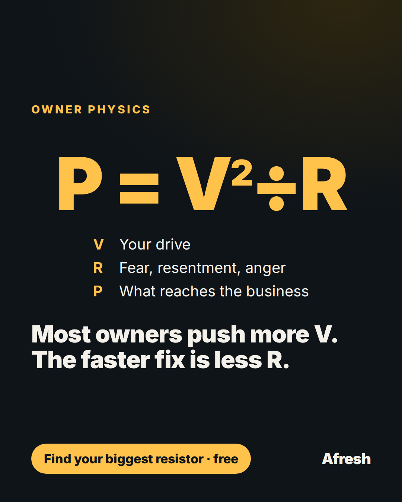 | 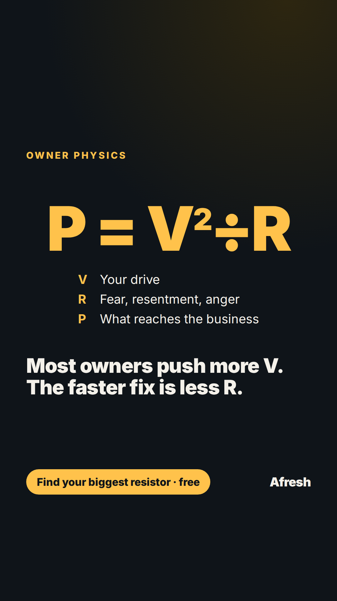 |

**Primary text**

> P = V² ÷ R
> 
> Power equals voltage squared, divided by resistance. When results stall, most owners push more voltage: more hours, more willpower.
> 
> The faster fix is less resistance. In a business that usually means fear, resentment and anger, and from the inside they rarely look like that. They look like being busy.
> 
> Find your biggest resistor in 3 minutes. Free.

**Headline:** Where is your power going?  
**Description:** 3 minutes. Free.  
**Button:** Learn more

### `R1_OWN-POWER_P3-bulb`

| Feed 4:5 | Story 9:16 |
|---|---|
| 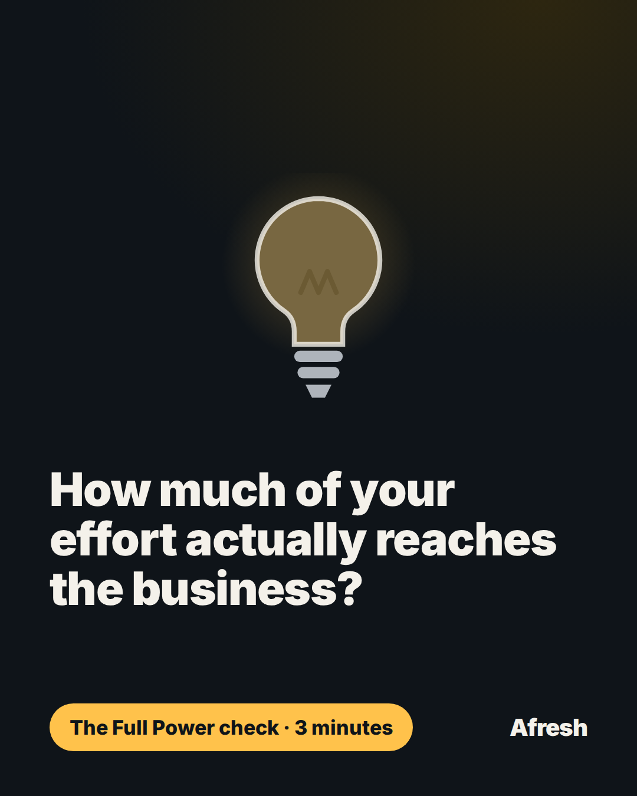 | 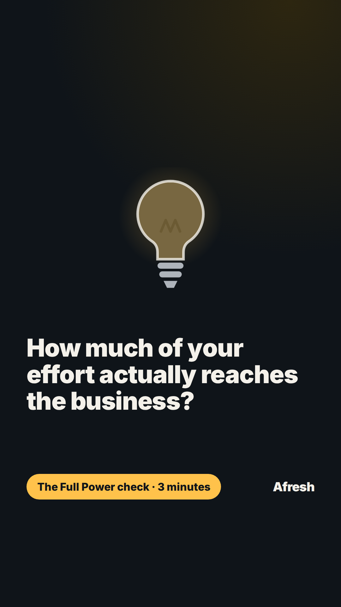 |

**Primary text**

> Sixty hours in. Not sixty hours of results out.
> 
> That gap has a name: resistance. The decision that gets put off, the resentment that gets carried, the reaction that gets regretted. Each one burns energy before it reaches the business.
> 
> Doug Stevenson spent 23 years as a founder and CEO. His free Full Power check finds the leak in 3 minutes, without blame.

**Headline:** Find the leak in 3 minutes  
**Description:** Free check for owners  
**Button:** Learn more

## OWN-CALM: Calm under pressure: a 60-second 4-7-8 reset before hard calls, then a 5-day Calm Operator email series

- **Ad set:** `R1_OWN-CALM`
- **Audience:** Business owners and founders
- **Landing page:** https://afresh.io/reset/
- **Lead magnet:** Guided 4-7-8 reset (ungated) + 5-day Calm Operator series
- **Hypothesis:** Cheapest clicks and leads of the owner cells, weakest booking rate. Tests whether stress content can feed coaching or only attracts free-content seekers.

### `R1_OWN-CALM_C1-478`

| Feed 4:5 | Story 9:16 |
|---|---|
| 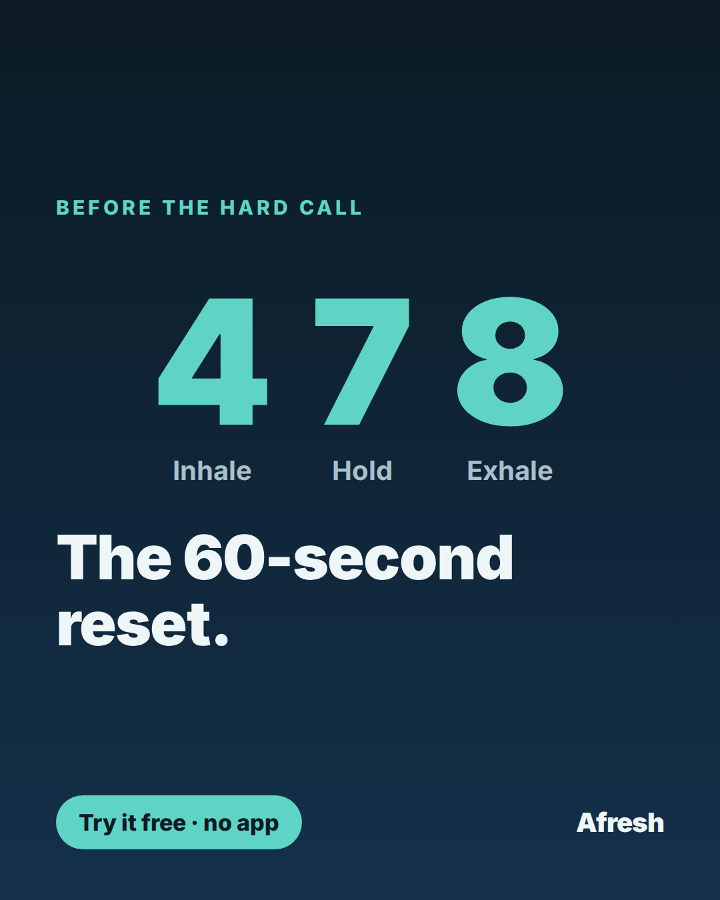 | 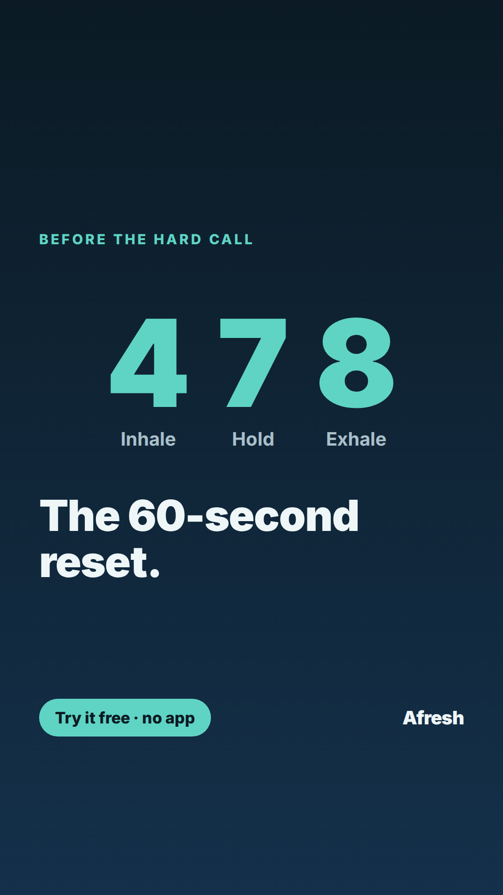 |

**Primary text**

> Inhale 4. Hold 7. Exhale 8.
> 
> A one-minute reset for the moment before a hard call: the price conversation, the tough feedback, the email that is about to go out.
> 
> No app. Works anywhere. Try it free with a guide, right now.

**Headline:** The 60-second reset before a hard call  
**Description:** Try it free  
**Button:** Learn more

### `R1_OWN-CALM_C2-pregame`

| Feed 4:5 | Story 9:16 |
|---|---|
| 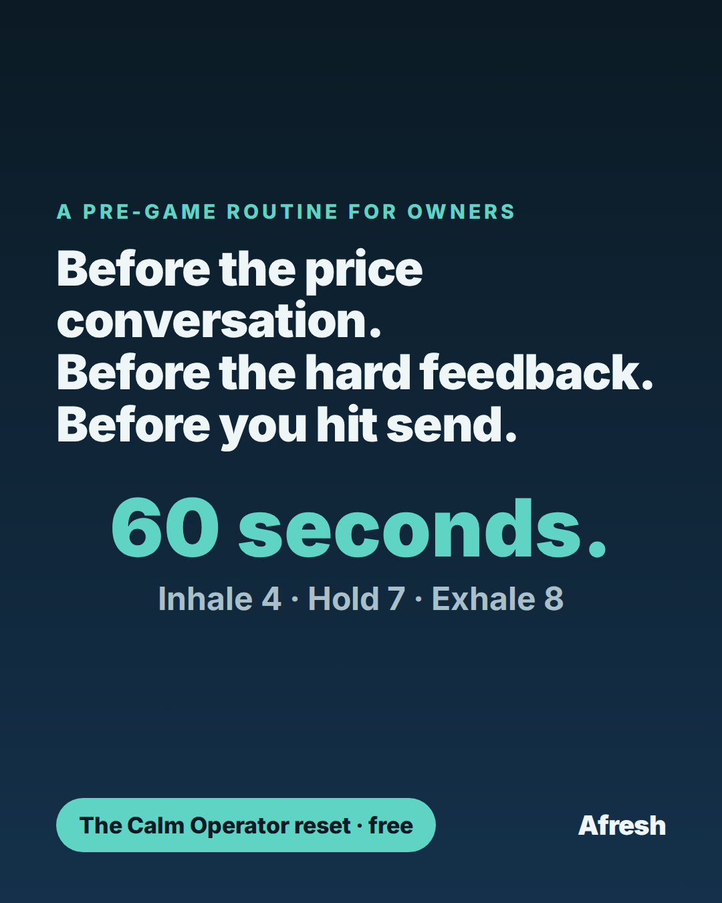 | 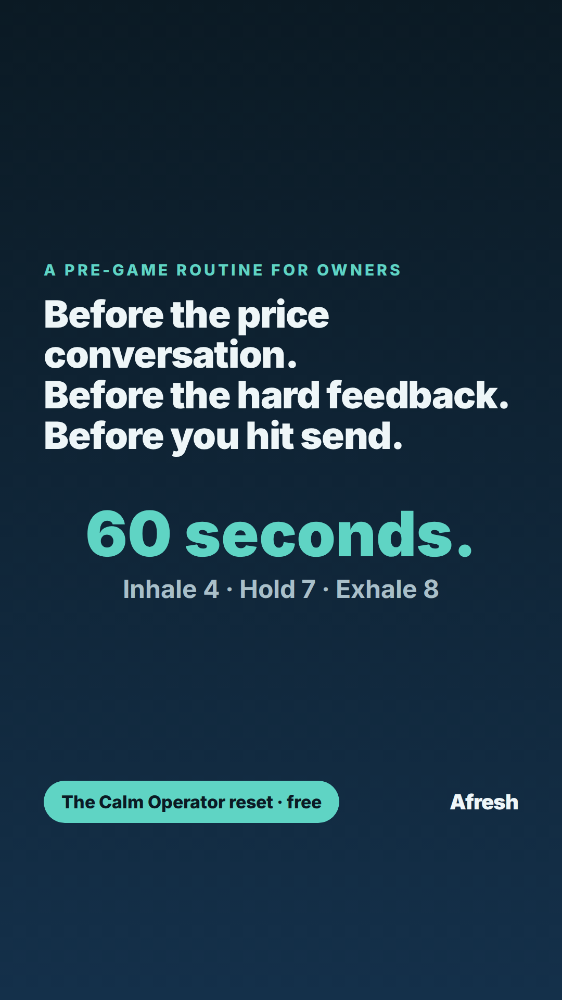 |

**Primary text**

> Athletes have a pre-game routine. Pilots have a pre-flight checklist. Most owners walk into their hardest calls cold.
> 
> This routine takes 60 seconds: a 4-7-8 breath, three rounds. Use it before any conversation that matters.
> 
> Then, if it helps, get the free 5-day Calm Operator reset: one technique a day, built for the pressure of running a business.

**Headline:** A pre-game routine for hard calls  
**Description:** 60 seconds. Free.  
**Button:** Learn more

### `R1_OWN-CALM_C3-mantra`

| Feed 4:5 | Story 9:16 |
|---|---|
| 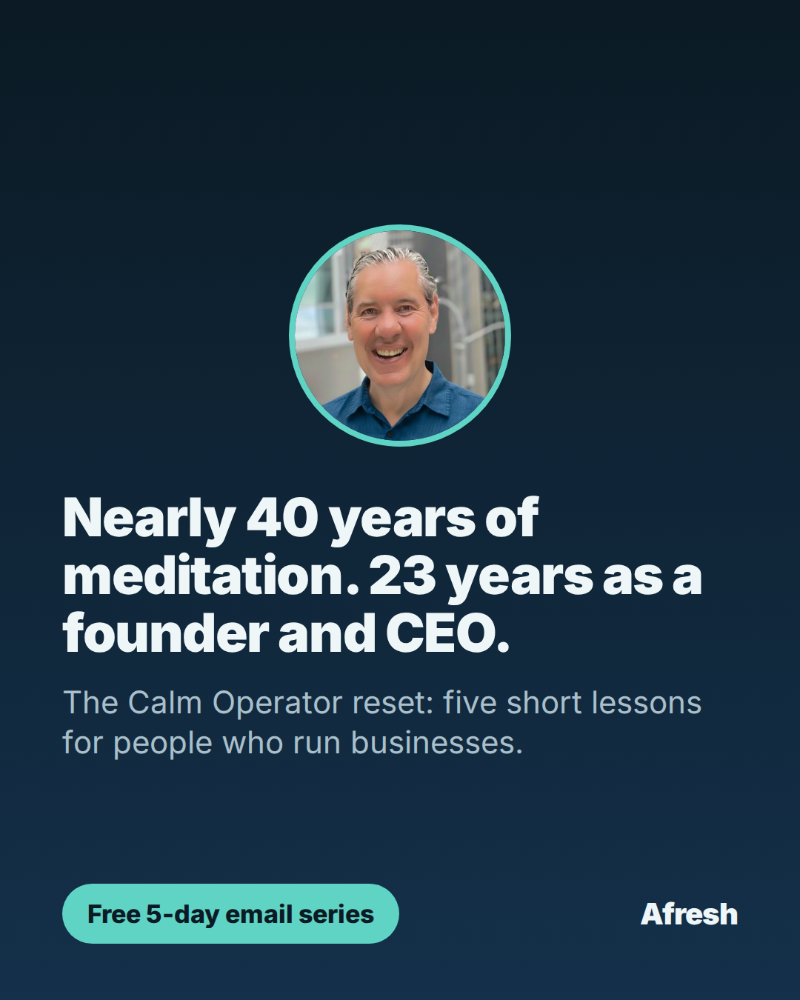 | 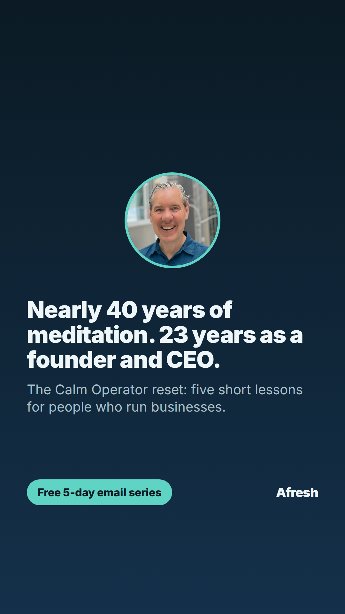 |

**Primary text**

> Doug Stevenson has meditated for nearly 40 years, including 23 years as a founder and CEO.
> 
> The Calm Operator reset is what he teaches owners: five short emails, one technique a day. The 60-second breath. Choosing a mantra. The worry dump. The shutdown ritual. Protecting sleep like it is part of the job.
> 
> Free, and built for people who run businesses.

**Headline:** 5 days to a calmer operator  
**Description:** Free email series  
**Button:** Sign up

## OWN-HABIT: Behavior design: stop running the business on willpower (BJ Fogg's Tiny Habits)

- **Ad set:** `R1_OWN-HABIT`
- **Audience:** Business owners and founders
- **Landing page:** https://afresh.io/tiny-habits/
- **Lead magnet:** Tiny Habits recipe builder (ungated) + 5-day starter
- **Hypothesis:** Practical, low-threat entry point. Tests whether a method-led promise beats an emotion-led one.

### `R1_OWN-HABIT_H1-recipe`

| Feed 4:5 | Story 9:16 |
|---|---|
| 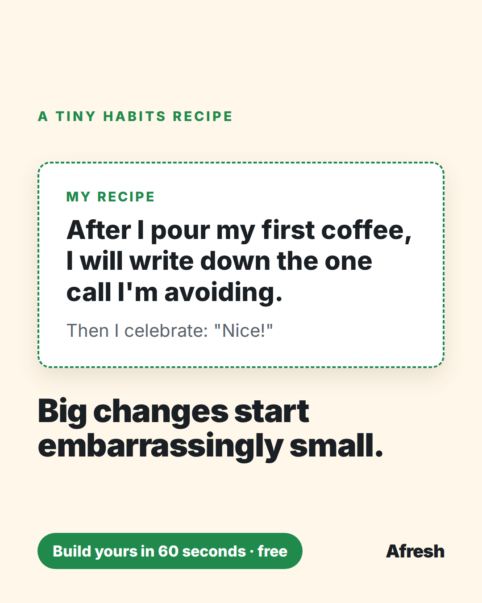 | 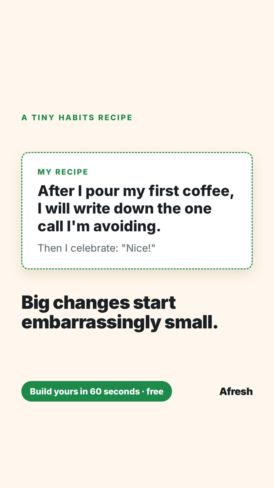 |

**Primary text**

> "After I pour my first coffee, I will write down the one call I'm avoiding."
> 
> That's a Tiny Habits recipe: an anchor that already happens every day, a behavior so small it works on the worst day, and a quick celebration.
> 
> Build a first owner habit in 60 seconds, free. Based on BJ Fogg's Tiny Habits method, from a coach he certified.

**Headline:** Build your first owner habit  
**Description:** 60 seconds. Free.  
**Button:** Learn more

### `R1_OWN-HABIT_H2-willpower`

| Feed 4:5 | Story 9:16 |
|---|---|
| 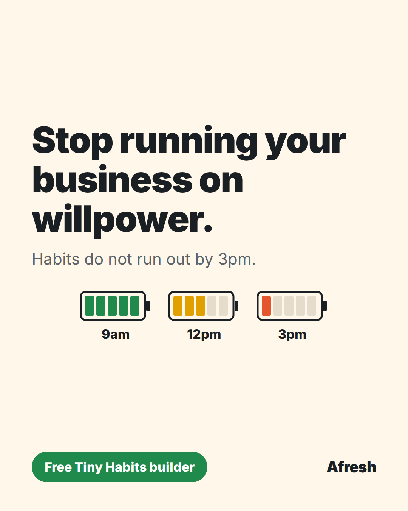 | 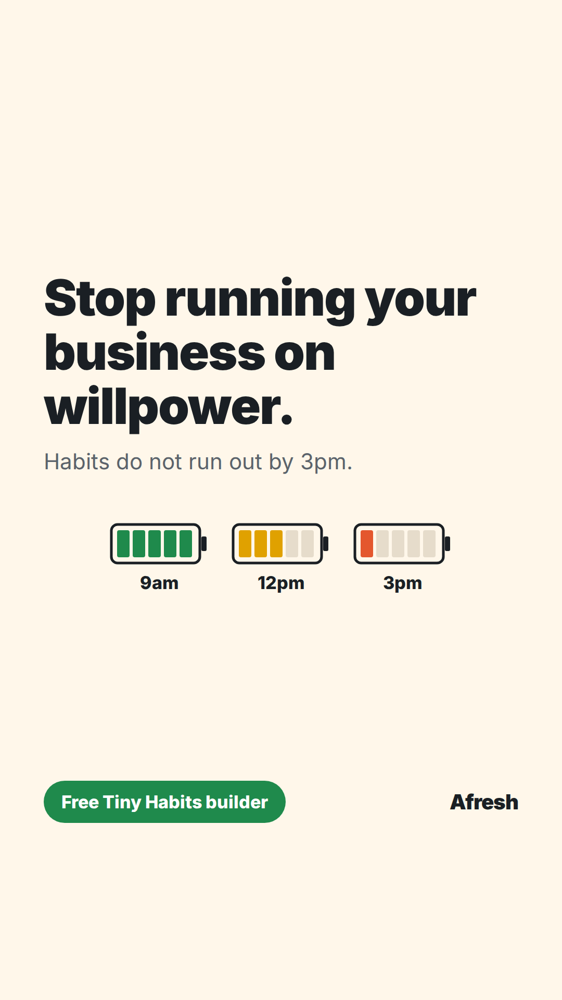 |

**Primary text**

> Willpower is gone by 3pm. Habits aren't.
> 
> BJ Fogg's research at Stanford says a behavior happens when motivation, ability and a prompt meet. Most owners keep trying to fix motivation. It's the least reliable of the three.
> 
> Make it tiny. Anchor it. Celebrate it. Build a first recipe in 60 seconds.

**Headline:** Stop running on willpower  
**Description:** Free habit builder  
**Button:** Learn more

### `R1_OWN-HABIT_H3-bmap`

| Feed 4:5 | Story 9:16 |
|---|---|
| 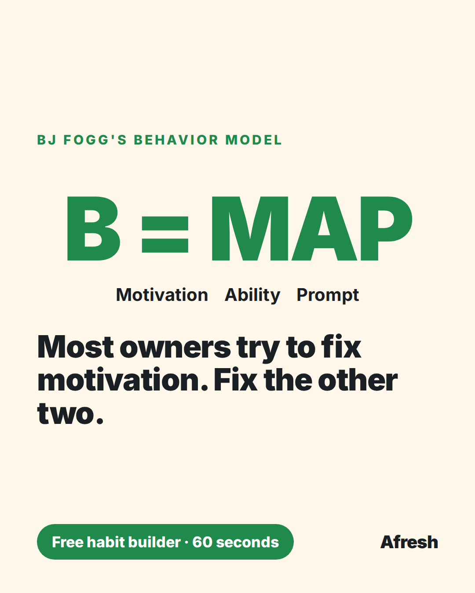 | 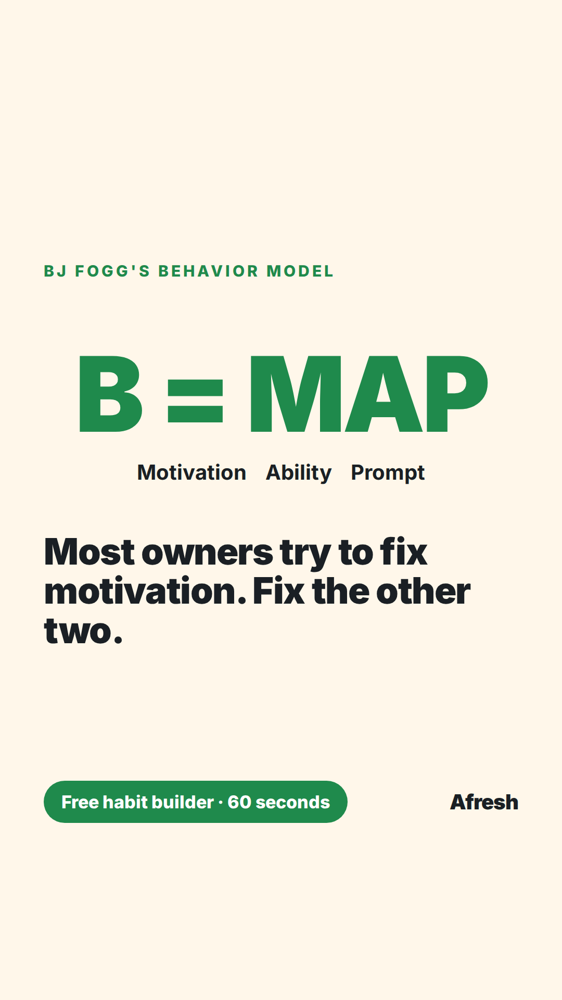 |

**Primary text**

> B = MAP
> 
> A behavior happens when Motivation, Ability and a Prompt show up at the same moment. That's BJ Fogg's model, and it explains why most New Year plans are gone by February.
> 
> Owners don't need more motivation. They need smaller behaviors with better prompts. Free 60-second habit builder plus a 5-day starter.

**Headline:** The formula behind habits that stick  
**Description:** Free for owners  
**Button:** Learn more

## CAREER: A career move is a campaign, not a job search

- **Ad set:** `R1_CAREER`
- **Audience:** Experienced professionals considering a move (includes engineers and product managers)
- **Landing page:** https://afresh.io/career-move/
- **Lead magnet:** Career Campaign Scorecard (12-question assessment, gated result)
- **Hypothesis:** The challenger cohort. Likely the highest intent and lead volume; tests whether it books more calls per dollar than owners.

### `R1_CAREER_K1-campaign`

| Feed 4:5 | Story 9:16 |
|---|---|
| 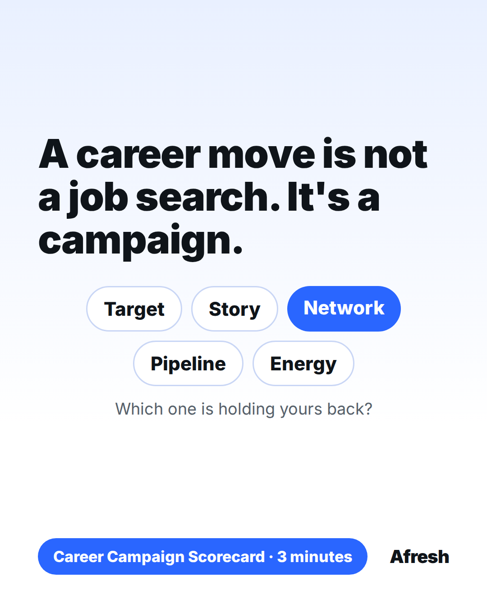 | 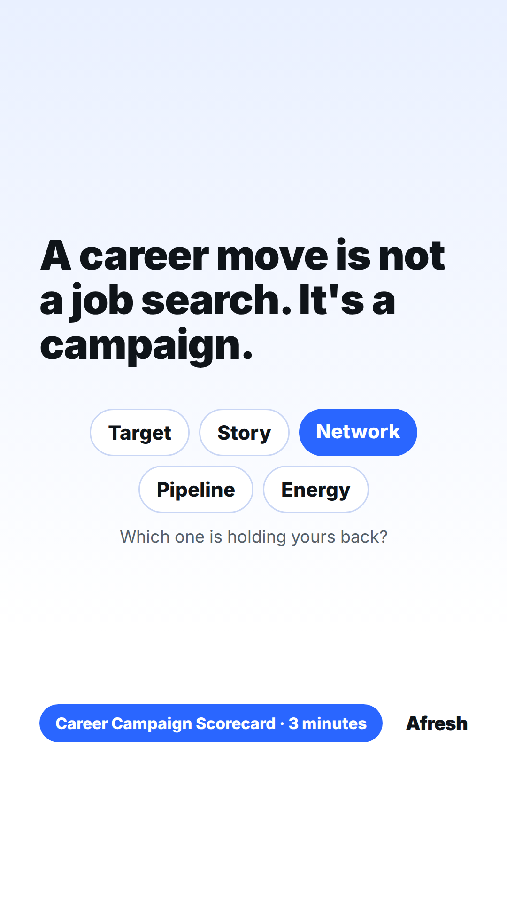 |

**Primary text**

> A career move isn't a job search. It's a campaign.
> 
> Searches stall on one of five things: a blurry target, a story that undersells, an untapped network, no pipeline, or running out of energy.
> 
> The free Career Campaign Scorecard shows which one in 3 minutes, with three things to do about it this week.

**Headline:** Get your Career Campaign score  
**Description:** 3 minutes. Free.  
**Button:** Learn more

### `R1_CAREER_K2-title`

| Feed 4:5 | Story 9:16 |
|---|---|
| 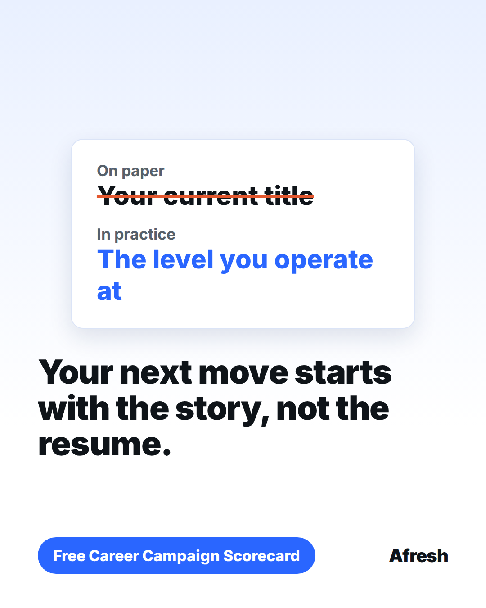 | 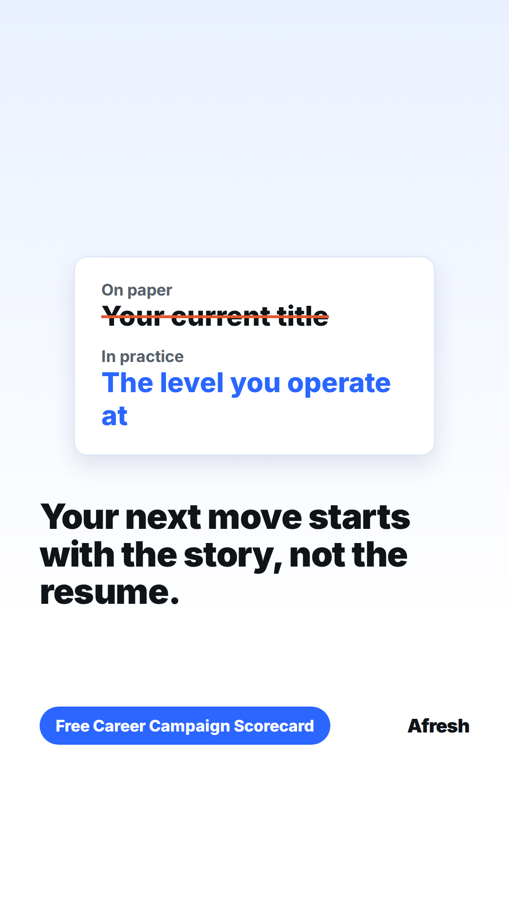 |

**Primary text**

> The title on a resume is rarely the level someone actually operates at.
> 
> Experienced people undersell themselves in exactly the place that matters: the one-minute story of where they've been and where they're going next.
> 
> The free 3-minute Career Campaign Scorecard shows whether target, story, network, pipeline or energy is holding a move back.

**Headline:** Find what's holding your move back  
**Description:** Free scorecard  
**Button:** Learn more

### `R1_CAREER_K3-conversations`

| Feed 4:5 | Story 9:16 |
|---|---|
| 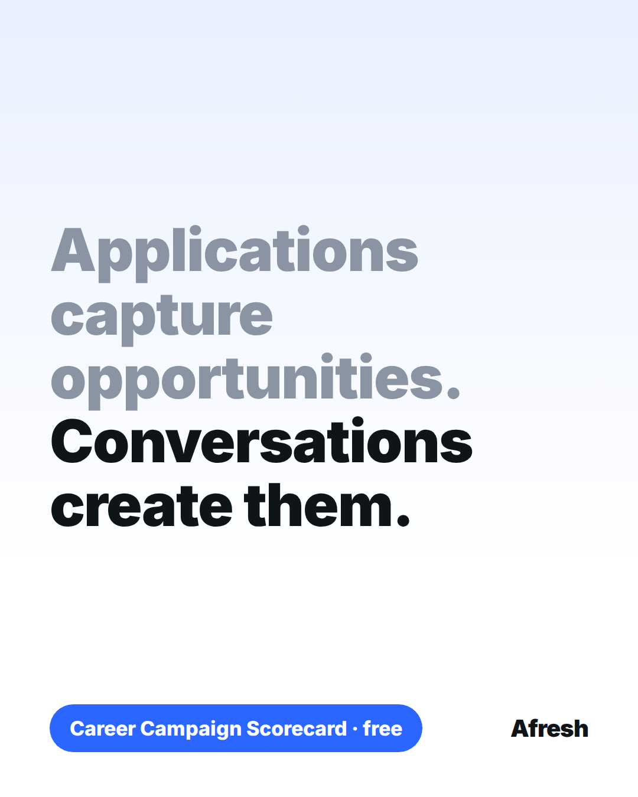 | 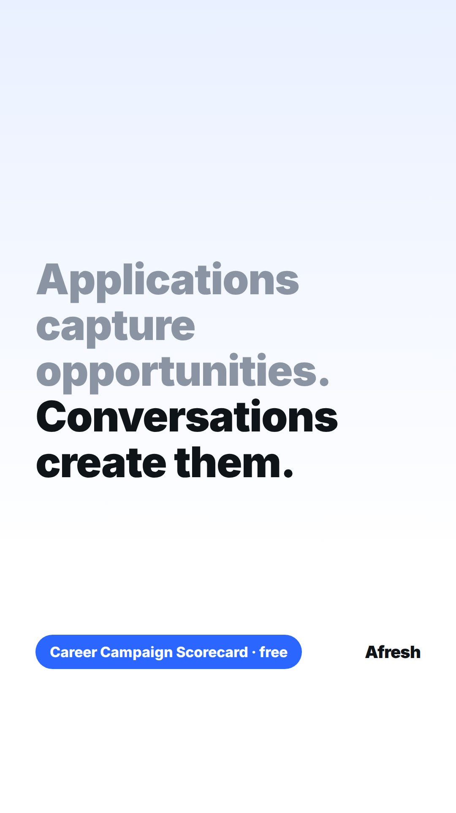 |

**Primary text**

> Conversations create opportunities. Applications only capture them.
> 
> A search that runs mostly on job boards competes where it's hardest. The strongest moves come through people who already know the work.
> 
> The free Career Campaign Scorecard shows where a next move is stuck. Built by Doug Stevenson, founder and CEO for 23 years, now a career transition coach.

**Headline:** Where is your next move stuck?  
**Description:** 3-minute scorecard  
**Button:** Learn more

